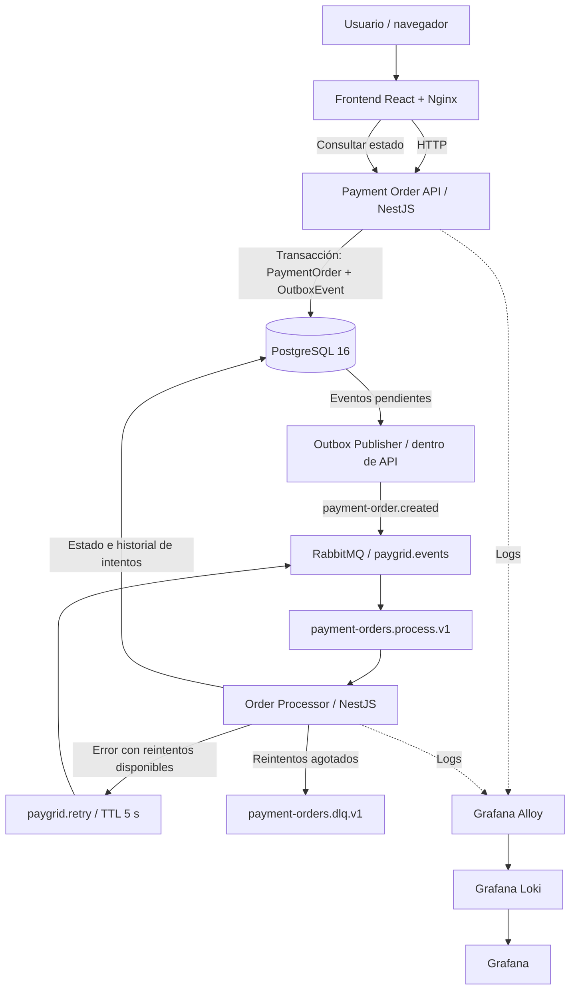

# PayGrid — Proyecto I | Message Queue y Retry

**Universidad Nacional de Costa Rica · Sede Regional Chorotega · Campus Nicoya**  
**Curso:** Paradigmas de Programación  
**Integrantes:** Dauren Matarrita Prendas, Daniel Marchena Matarrita, Ronny Salas Azofeifa y Samira Zuñiga Quesada.

> **Guía oficial de instalación, uso y comprobación.** PayGrid es una **simulación académica** de órdenes de pago: no transfiere dinero ni se conecta a bancos. El repositorio conserva el nombre histórico `Content-moderation-queue`, pero la aplicación actual es PayGrid.

## Índice

1. [Problema asignado y técnica utilizada](#1-problema-asignado-y-técnica-utilizada)
2. [Arquitectura y diagrama](#2-arquitectura-y-diagrama)
3. [URL del ambiente desplegado](#3-url-del-ambiente-desplegado)
4. [Imágenes de Docker Hub](#4-imágenes-de-docker-hub)
5. [Cómo ejecutar el proyecto en la computadora del profesor](#5-cómo-ejecutar-el-proyecto-en-la-computadora-del-profesor)
6. [Manual de uso y simulación](#6-manual-de-uso-y-simulación)
7. [Cómo comprobar que la técnica funciona](#7-cómo-comprobar-que-la-técnica-funciona)
8. [Solución de problemas y comandos útiles](#8-solución-de-problemas-y-comandos-útiles)
9. [Documentación técnica y estado de entrega](#9-documentación-técnica-y-estado-de-entrega)

## 1. Problema asignado y técnica utilizada

Cuando una aplicación procesa una orden de pago dentro de la misma solicitud HTTP, el cliente debe esperar y la disponibilidad de la API depende del procesamiento. PayGrid desacopla la **aceptación de órdenes** de su **procesamiento**: la API registra la orden en estado `PENDING` y un servicio separado la procesa después.

La técnica principal es **Message Queue**, implementada con **RabbitMQ**, y una política de **Retry** ante fallos transitorios o simulados. Se complementa con **Transactional Outbox** (orden y evento en una misma transacción de PostgreSQL), confirmaciones manuales **ACK**, protección frente a duplicados, **Dead Letter Queue (DLQ)** y **consistencia eventual**. El sistema ofrece escenarios deterministas para observar su comportamiento.

## 2. Arquitectura y diagrama



**Responsabilidades:** el frontend envía peticiones HTTP a la API; la API registra órdenes y eventos; el Outbox Publisher publica eventos; **RabbitMQ es el broker, no el worker**; el **Order Processor es el consumidor**; PostgreSQL almacena órdenes, estados e intentos; Alloy, Loki y Grafana forman la infraestructura local de observabilidad. El frontend nunca se conecta directamente a RabbitMQ.

En RabbitMQ, el evento `payment-order.created` llega a `payment-orders.process.v1`. Los fallos recuperables pasan por una cola de retry con espera de 5 segundos; cuando se agotan los reintentos, el mensaje se dirige a `payment-orders.dlq.v1`.

Más información: [arquitectura detallada](docs/architecture.md) y [diagrama interactivo](docs/architecture/diagrams/paygrid-high-level.architecture.html).

## 3. URL del ambiente desplegado

**Ambiente público remoto:** **[PENDIENTE DE VERIFICAR / INCORPORAR URL]**. No debe confundirse un `localhost` con una URL pública.

Tras ejecutar PayGrid en **su propia computadora**, el profesor podrá acceder a:

| Componente | URL local en la computadora que ejecuta Docker |
| --- | --- |
| Dashboard PayGrid | <http://localhost:8080> |
| API | <http://localhost:3000> |
| Documentación Swagger | <http://localhost:3000/docs> |
| RabbitMQ Management | <http://localhost:15672> |
| Grafana | <http://localhost:3001> |

RabbitMQ Management y Grafana se exponen únicamente en la interfaz local `127.0.0.1` según `compose.yaml`. Sus usuarios y contraseñas se configuran en `.env`.

## 4. Imágenes de Docker Hub

Docker Hub **no proporciona un ejecutable `.exe` de PayGrid**. Almacena imágenes listas para que Docker las descargue y ejecute como contenedores. **Docker Compose** lee el archivo `compose.yaml`, descarga las imágenes necesarias y arranca todos los servicios conectados.

| Imagen propia configurada | Uso |
| --- | --- |
| [`danieleng96/paygrid-backend:1.0.0`](https://hub.docker.com/r/danieleng96/paygrid-backend) | Misma imagen para los contenedores `api` y `order-processor`, con distintos comandos |
| [`danieleng96/paygrid-frontend:1.0.0`](https://hub.docker.com/r/danieleng96/paygrid-frontend) | Interfaz React servida por Nginx |

Compose también utiliza imágenes oficiales o de sus proveedores para PostgreSQL, RabbitMQ, Grafana, Loki y Alloy.

**Verificación de publicación:** las etiquetas anteriores constan en `compose.yaml` y `.env.example`, pero **la publicación efectiva y la correspondencia con la versión final deben validarse con `docker compose pull` y una prueba funcional limpia**. No asumir que una etiqueta configurada prueba que existe o que está actualizada.

## 5. Cómo ejecutar el proyecto en la computadora del profesor

### 5.1 Requisitos

- Docker Desktop iniciado (Windows/macOS), o Docker Engine con Compose (Linux).
- Git para obtener el repositorio y sus archivos de configuración.
- Acceso a Internet para descargar imágenes.

**No es necesario instalar Node.js, pnpm, NestJS, PostgreSQL ni RabbitMQ en el sistema anfitrión.**

Verificar Docker:

```powershell
docker --version
docker compose version
docker info
```

### 5.2 Descargar los archivos del proyecto

En **PowerShell**:

```powershell
git clone https://github.com/DanielMarchenaMatarrita/Content-moderation-queue.git
cd Content-moderation-queue
Copy-Item .env.example .env
```

En Linux/macOS, usar `cp .env.example .env` en lugar de `Copy-Item`. El repositorio aporta `compose.yaml` y las configuraciones montadas por los servicios de observabilidad; **clonar el repositorio no significa compilarlo**.

### 5.3 Configurar las credenciales

Abrir `.env` con un editor de texto y asignar **contraseñas no vacías** a:

```dotenv
POSTGRES_PASSWORD=CAMBIAR_POR_CONTRASENA_SEGURA
RABBITMQ_PASSWORD=CAMBIAR_POR_CONTRASENA_SEGURA
GRAFANA_ADMIN_PASSWORD=CAMBIAR_POR_CONTRASENA_SEGURA
```

Los valores son ejemplos, **no credenciales recomendadas**. Usar valores propios; las contraseñas de PostgreSQL y RabbitMQ deben ser compatibles con su interpolación en URL (preferiblemente caracteres alfanuméricos para esta demostración). No subir `.env` al repositorio. Mantener las variables restantes de `.env.example`, incluidas las etiquetas de imágenes.

### 5.4 Descargar imágenes y arrancar sin compilar

Este es el **procedimiento oficial de evaluación desde Docker Hub**:

```powershell
docker compose pull
docker compose up -d --no-build
docker compose ps
```

- `pull`: descarga las imágenes referenciadas en Compose, incluidas las de PayGrid.
- `up -d --no-build`: inicia contenedores en segundo plano **sin construir imágenes desde el código fuente**.
- `ps`: muestra qué servicios están ejecutándose.

Los ocho servicios esperados son `postgres`, `rabbitmq`, `api`, `order-processor`, `frontend`, `loki`, `alloy` y `grafana`. `postgres`, `rabbitmq`, `api` y `frontend` incluyen healthchecks; los demás deben revisarse mediante logs o su interfaz. La API ejecuta las migraciones Prisma al arrancar.

Si `docker compose pull` falla porque una imagen no está disponible, **no sustituirlo por `--build` para simular que la publicación está completa**: hay que publicar o corregir la imagen correspondiente.

### 5.5 Abrir la aplicación

1. Abrir <http://localhost:8080> en el navegador de la misma computadora.
2. Confirmar que aparece el dashboard de PayGrid.
3. Si no carga, ejecutar `docker compose ps` y `docker compose logs --tail=100 api frontend`.

### 5.6 Alternativa para desarrollo desde el código fuente

Solo para desarrollar o comprobar modificaciones locales:

```powershell
docker compose up -d --build
```

Este comando **sí construye** el frontend y el backend desde el código fuente. **No es el flujo principal de evaluación del profesor**.

## 6. Manual de uso y simulación

### 6.1 Conocer el dashboard

En <http://localhost:8080>, el dashboard presenta estadísticas de órdenes y una vista `System flow`. La sección de órdenes permite crear, listar y consultar el procesamiento; el detalle muestra `Processing journey`, estados, reintentos y errores registrados.

### 6.2 Crear una orden

1. Seleccionar **Create order**.
2. Introducir un monto de prueba, por ejemplo `15000`, y moneda `CRC`.
3. Seleccionar el escenario de simulación.
4. Enviar la orden.
5. Abrir su detalle y observar cómo cambia de `PENDING` al estado final. La interfaz consulta periódicamente la API mientras está pendiente.

También se puede utilizar Swagger en <http://localhost:3000/docs>, mediante `POST /orders`.

### 6.3 Escenarios de demostración

| Escenario | Secuencia de procesamiento esperada | Estado final | `retryCount` |
| --- | --- | --- | --- |
| `SUCCESS` | Intento inicial correcto | `SUCCESS` | 0 |
| `FAIL_ONCE` | Error inicial → Retry 1 correcto | `SUCCESS` | 1 |
| `FAIL_TWICE` | Error inicial → Retry 1 error → Retry 2 correcto | `SUCCESS` | 2 |
| `ALWAYS_FAIL` | Error inicial → Retry 1 error → Retry 2 error → Retry 3 error | `FAILED` | 3 |

**Importante:** son **3 reintentos adicionales** al primer intento; el máximo por ciclo agotado es de **4 intentos**. El retraso de la cola de retry es de aproximadamente **5 segundos** entre intentos.

### 6.4 Demostración recomendada paso a paso

1. Crear una orden `SUCCESS` y verificar un intento exitoso y `retryCount = 0`.
2. Crear una orden `FAIL_TWICE`; observar dos errores seguidos de un éxito en `Processing journey`.
3. Crear una orden `ALWAYS_FAIL`; esperar los cuatro intentos fallidos y verificar estado `FAILED`.
4. Abrir RabbitMQ Management en <http://localhost:15672>, iniciar sesión con `RABBITMQ_USER` (por defecto `paygrid`) y `RABBITMQ_PASSWORD` de `.env`.
5. En **Queues**, inspeccionar `payment-orders.dlq.v1` para comprobar que el mensaje agotado llegó a la cola de mensajes fallidos.
6. Regresar al detalle de la orden fallida y seleccionar **Reprocess order**. La recuperación manual inicia un **nuevo evento** y preserva el historial de los intentos anteriores; no consume ni reproduce el mensaje original de la DLQ.
7. Confirmar que el nuevo procesamiento puede terminar en `SUCCESS` y que el historial sigue disponible.

### 6.5 Inspeccionar la observabilidad

1. Abrir <http://localhost:3001> e iniciar sesión con `GRAFANA_ADMIN_USER` (por defecto `admin`) y `GRAFANA_ADMIN_PASSWORD` de `.env`.
2. Comprobar que Loki está configurado como fuente de datos y explorar los logs disponibles.
3. Generar nuevas órdenes y relacionar los registros de `api` y `order-processor` con las operaciones realizadas.
4. Si no hay registros, revisar `docker compose logs --tail=100 alloy loki grafana`. **Que Grafana abra no demuestra por sí solo que la recolección de logs funcione.**

## 7. Cómo comprobar que la técnica funciona

| Qué comprobar | Procedimiento | Evidencia esperada |
| --- | --- | --- |
| Comunicación asíncrona | Crear orden y observar detalle | Estado inicial `PENDING`, resultado posterior sin esperar el procesamiento en la petición HTTP |
| Broker y consumidor independientes | Inspeccionar RabbitMQ y logs del procesador | Mensaje encaminado y consumido por `order-processor` |
| Retry | Ejecutar `FAIL_TWICE` | Dos errores, éxito posterior, `retryCount = 2` |
| DLQ | Ejecutar `ALWAYS_FAIL` | Cuatro errores, `FAILED`, mensaje en `payment-orders.dlq.v1` |
| Historial persistente | Abrir detalle y recargar | Intentos previos permanecen disponibles |
| Recuperación manual | Usar **Reprocess order** | Nuevo evento e intento; historial anterior intacto |
| Observabilidad | Abrir Grafana y consultar Loki | Logs de operaciones recientes de los servicios |
| Imágenes publicadas | `docker compose pull` en máquina limpia | Descarga exitosa de imágenes y arranque sin compilación |

**Semántica de entrega:** RabbitMQ proporciona una estrategia *at-least-once*, por lo que puede haber redelivery. La aplicación usa `ProcessedMessage` y comprobaciones del consumidor para protegerse contra duplicados. **No se afirma procesamiento exactly-once.**

Para evidencia de evaluación se recomienda capturar: dashboard, detalle `FAIL_TWICE`, detalle `ALWAYS_FAIL`, DLQ en RabbitMQ, recuperación manual y consulta de logs en Grafana. Las capturas deben corresponder a una ejecución real, no a resultados supuestos.

## 8. Solución de problemas y comandos útiles

| Problema | Qué revisar |
| --- | --- |
| Docker no responde | Iniciar Docker Desktop y ejecutar `docker info` |
| Falta una contraseña | Completar las tres variables obligatorias de `.env` |
| Imagen no encontrada en Docker Hub | Verificar el nombre, etiqueta, acceso público y publicación de la imagen; repetir `docker compose pull` |
| API o frontend no arranca | `docker compose ps` y `docker compose logs --tail=100 api frontend` |
| RabbitMQ no conecta | `docker compose logs --tail=100 rabbitmq order-processor` y credenciales de `.env` |
| No aparecen logs en Grafana | Revisar `alloy`, `loki`, `grafana` y el origen de datos |
| Puerto 8080, 3000, 15672 o 3001 ocupado | Liberar el puerto o adaptar la publicación en `compose.yaml` antes de reiniciar |
| Se ejecuta una versión antigua | Confirmar las etiquetas publicadas y volver a descargar las imágenes; no asumir que un tag representa el último commit |

```powershell
# Ver contenedores
docker compose ps

# Consultar logs
docker compose logs --tail=100 api order-processor

# Seguir logs en vivo
docker compose logs -f api order-processor

# Detener sin eliminar datos
docker compose down
```

**Advertencia:** `docker compose down -v` elimina los volúmenes de datos; puede borrar órdenes, intentos, mensajes y configuración persistida. No utilizarlo durante la evaluación salvo que se desee reiniciar desde cero.

## 9. Documentación técnica y estado de entrega

- [Arquitectura detallada, topología de RabbitMQ, Outbox, ACK e idempotencia](docs/architecture.md).
- [Guía técnica ampliada, migraciones, endpoints y diagnóstico](docs/development.md).
- [Repositorio principal de PayGrid](https://github.com/DanielMarchenaMatarrita/Content-moderation-queue).

### Lista de verificación para entregar

- [x] README con problema, técnica, arquitectura, imágenes configuradas, ejecución, simulación y comprobación.
- [x] Procedimiento para que el profesor ejecute imágenes sin compilar código.
- [x] Manual de uso con los cuatro escenarios y recuperación manual.
- [ ] Confirmar que ambas imágenes de PayGrid estén publicadas y actualizadas en Docker Hub.
- [ ] Realizar una instalación limpia con `docker compose pull` y `docker compose up -d --no-build`.
- [ ] Adjuntar o indicar la URL del ambiente remoto, si la evaluación exige despliegue público.
- [ ] Verificar mediante ejecución real que Grafana recibe los logs esperados.

> **Criterio de aceptación:** el profesor clona el repositorio, configura `.env`, descarga las imágenes, inicia los ocho servicios, crea órdenes y comprueba Retry, DLQ, persistencia y observabilidad sin construir el código fuente.
